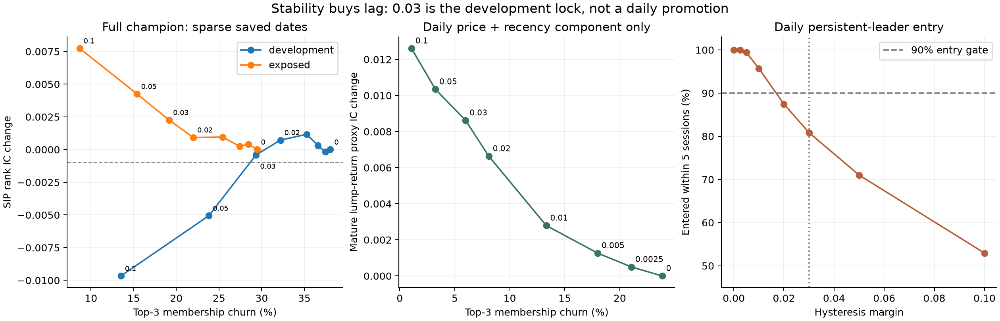

# Second research round — 31 October 2026

The incumbent stays unchanged. The sector structure failed its placebo gate; larger hysteresis margins buy stability but create measurable lag; both risk objectives fail the drawdown requirement. Goal scenarios and the older survivorship-free test remain unresolved because their required evidence is incomplete. No application, website, or serving weights changed.

This extends published baseline `6e9bd620e4472c8280536b6120fe86d10dca65cb`. Existing development dates are 2020–2023; 2024–2025 are already exposed diagnostics, not a fresh holdout. Protocols were written before each new outcome evaluation. Control-replay fixes used saved scores, not new performance-based parameter choices.

| Workstream | Result | Decision |
|---|---|---|
| Sector shuffle | Full score replay error 4.44e-16; 50 fixed shuffles; original sectors do not clear the hurdle | Current sector structure has not demonstrated incremental value |
| Hysteresis | Development locks 0.03; daily component churn falls 74.90%, but only 80.84% of persistent leaders enter within five sessions | Lag gate fails; do not promote |
| Historical universe | 2,495 official membership events; 96/96 month-end exchange inventories; former identities retained | Primary SIP IC test blocked by membership/price/terminal prerequisites |
| Goal scenarios | Only development bull cases have adequate conditional benchmarks | Not estimable under the preregistered both-period/all-scenario gate |
| Goal-risk objectives | Both worsen selected-asset drawdown; attainment also fails in at least one period | Keep incumbent |
| Prospective ledger | Two public, hash-linked records; daily 19:30 IST schedule; exchange metadata acquisition active | Scores remain stale and ineligible for the fresh holdout |
| Meta/disagreement | No additional mature PIT labels yet | Deferred, not rejected |

## Sector-shuffle placebo

All sector-conditioned downstream inputs were recalculated: original sector-score components, legacy feature percentiles, both annual rankers and their continuity blend, CatBoost/Ridge output percentiles, profile head, full-population price percentiles/context, and high/SIP overlays. Frozen fitted weights were reused. The Ridge pickle predates the installed sklearn ABI; its stored imputation, indicator, scaling and linear coefficients were evaluated directly. A unit test checks that arithmetic against a fitted pipeline, and the complete unshuffled replay matches all 88,962 base-profile scored rows within 4.44e-16.

An important implementation detail: price input normalization uses the complete 4,436-identity population, while legacy scoring has a smaller dated population. Labels were permuted within dates, separately inside the legacy population and its complement, preserving group sizes in both populations. The same issuer assignment was reused across every component. Evaluation always uses the original true-sector queries, with the same outcome/evidence support. This stratification is the concrete implementation of the registered size-preserving permutation; it is not an unrestricted uniform draw across the full population.

| Period | Real IC | Mean shuffled IC | 95th percentile shuffled IC | Real minus mean shuffle, 95% date-block interval |
|---|---:|---:|---:|---:|
| Development | 0.022582 | 0.019395 | 0.023996 | +0.003186 [-0.003166, +0.009827] |
| Exposed | 0.153458 | 0.158935 | 0.162674 | -0.005478 [-0.008904, -0.001371] |

Development needed to exceed the shuffled 95th percentile by **0.010134924** and have a positive paired lower bound. Neither condition passed. The exposed direction is negative. Intervals resample paired per-date real-minus-average-shuffle differences in 365-day calendar blocks, 4,000 times. The shuffle percentile and the temporal interval are different quantities. This does not establish equivalence of a retrained sector-free model. It covers base7500, current-survivor identities and retrospective sectors; Unclassified retains its existing fallback semantics. Secondary global/pair-accuracy analyses were not completed; no secondary pass claim is made.

## Hysteresis frontier and daily replay

Margins were 0, .0025, .005, .01, .02, .03, .05 and .1. Development selected the lowest Top3 churn subject to IC loss at most .001, with smaller-margin tie breaking. Margin .03 changed sparse-date development churn from 38.04% to 29.34%, with IC delta -0.000408. In exposed dates, churn changed from 29.45% to 19.15%, with IC delta +0.002258. Margins .05 and .1 violated the development IC budget.



Daily replay covers 433 recovered sessions (1,920,788 issuer-session rows; 3,107–3,528 eligible identities per session) from 2025-01-01 through 2026-09-30. It rebuilds **.25 × annual price-head percentile + high-recency adjustment**, using 2025's saved annual head and a fixed-recipe 2026 head trained only on outcomes ending before 2026-01-01. It does not insert frozen open/profile/SIP terms and call them daily observations. The whole-score margin therefore has a different scale in this component diagnostic.

At the locked .03 margin, daily Top3 churn falls from 23.85% to 5.99%; Kendall tau rises from .7993 to .9433. Among 2,845 new raw Top3 entrants that persist at least five sessions, 80.84% enter the smoothed Top3 within five sessions, below the 90% gate. 15.43% are right-censored before entry. The reported p90 lag lower bound is six sessions, not a censoring-adjusted p90 estimate. The mature **lump-return proxy** IC delta is +.00862; this is not SIP IC and there is no mature 2026 performance claim. Persistent score leadership is not proof of future investment leadership; oracle outcome flags are separate diagnostics.

Safety removes blocked/missing/stale/nonfinite inputs, unresolved action windows and large one-session moves; known action dates reset sector order. Zero known blocked names were retained. Historical event broadcast availability and actual suspension coverage remain unknown. Retrospective ex-date resets cannot certify point-in-time detection of every split, suspension or delisting.

## Historical NIFTY 500: recovered data and remaining gate

The literature `universe_history` module was a validation scaffold with an empty source manifest, not a ready historical dataset. Acquired evidence now includes:

- Official NSE Nifty500 inclusion/exclusion workbook: **2,495 events**, 1998 through September 2020.
- **119** reconstitution notices, with conservative PDF extraction; **747** parser matches, covering **742 unique workbook events**, matched by date/action/name for symbol evidence. Unmatched parser rows remain in a review queue.
- Official name-change and symbol-change tables. A separate dated-rename audit adds 82 active-name bridges from 2012 onward and reduces the 15 literal sequence conflicts to **7**. Original and reconciled registries are both retained; unresolved conflicts are not forced away.
- An archived 500-name/500-ISIN constituent CSV captured on 2015-03-25. Capture time is not a certified content effective date. Its names match 497/500 entries in the rename replay at that date; the remaining differences are recorded.
- **96/96 month-end official bhavcopies** across 2012–2019: 161,183 exchange rows, **3,128 distinct ISINs**, including **1,745 outside today's survivor universe**. These are full-exchange identity/price observations, not 1,745 confirmed former NIFTY500 constituents.

The first archive host returned HTTP403; the official `nsearchives.nseindia.com` host supplied valid ZIPs. Every recovered CSV's internal observation date is checked against its requested session; holiday/weekend fallback is explicit and limited to seven calendar days. Missing/duplicate symbol-series observations cannot silently become clean data. Raw source downloads remain local; source URLs, hashes and compact derived inventories are published.

The original audit retains **48,360 member-month rows**, including unmatched identities. No survivor-only complete-case IC is presented as survivorship-free. The older-regime primary remains blocked: complete dated issuer membership/aliases, historical sector mapping, adjusted daily continuity, suspension/delisting/merger terminal proceeds, whole-share SIP outcomes, and causal pre-2020 full-champion training have not been verified. Month-end nominal closes do not solve these requirements. The raw-IC operational target .01013 is retained in the registration, but its origin is an *incremental model-selection* noise floor, not a universal null threshold for absolute IC.

## Goal probability scenarios

The diagnostic separates a stock's log gross SIP outcome from the same-date median outcome of the survivor base7500 cohort. That median is a retrospective SIP market proxy, not an observed NIFTY500 index return or a forecast feature. Annual relative models use strictly mature training and separate mature residual-calibration windows.

Fixed bear/flat/bull cases use market SIP-XIRR -20%, 0%, +20%. Probabilities apply the past-calibrated residual survival distribution to the target and scenario. Actual realized market conditioning is an oracle diagnostic only. This additive common-factor specification changes displayed probabilities as target CAGR changes; it does not establish target-dependent stock ordering. 84,184 matched cases pass target-probability monotonicity checks; 500 stored-model replay predictions match exactly.

The gate required conditional Brier below past conditional climatology in all three scenarios, in both periods, with sufficient date and row coverage. Only development bull cases had an adequate benchmark: Brier **.25107 versus .25667** on ten dates. Bear/flat calibration support is insufficient and exposed conditional benchmarks are unavailable. Overall status is **NOT ESTIMABLE**, not passed and not evidence that the idea fails.

The base-rate audit supports caution about attribution. Query-weighted universe hit frequency falls 56.52% → 22.46%, while champion Top3 attainment falls 57.64% → 22.96%; selection lift is +1.12pp → +0.50pp. In the prior goal model's row-weighted exposed Brier decomposition, squared mean-probability bias contributes .12535 of .30386. Climatology itself is stale and loses to an oracle test-rate constant. These arithmetic observations identify calibration drift; they do not prove a causal market explanation or that calibration failure is unavoidable.

## Risk-aware goal ranking

Two fixed policies were tested on matched query support. “Expected goal shortfall” predicts the conditional mean of stored target-wealth shortfall `max(0,1-terminal_wealth/target_wealth)`; it is not financial expected shortfall/CVaR. The other policy selects by prior goal probability only among stocks at/below the same-query sector median downside volatility.

| Policy | Development attainment delta | Development drawdown delta | Exposed attainment delta | Exposed drawdown delta |
|---|---:|---:|---:|---:|
| Mean goal shortfall | -3.47pp | -2.14pp | +1.42pp | -5.52pp |
| P(goal), lower-downside half | +0.83pp | -4.14pp | -1.32pp | -6.55pp |

Negative drawdown deltas mean worse average selected-asset drawdown. This is not a portfolio drawdown simulation. Neither policy meets the requirement that attainment not fall and drawdown not worsen in both periods. No replacement is promoted. Date-block intervals and coverage are in the evidence directory.

## Prospective ledger and acquisition

Public data branch: [prospective-ledger](https://github.com/harshil0014/stock-ranking-platform-checkpoint/tree/prospective-ledger). Bootstrap commit `78a3f53c8e09c8176f3a1343b16cf967860e8ecc`; financial-feed recovery commit `ff4b35bcfb25e82a632907c4798536c76d98ab8c`. Each manifest hashes every record file and links the previous manifest. Slot retries verify and reuse the original bytes; normal fast-forward pushes and compare-and-swap ref updates preserve history. GitHub branch protection currently disables force pushes and deletion and applies to administrators. This is operational protection and tamper evidence, not a claim that an owner can never change repository settings.

The first capture saved 4,317 announcements and 27 corporate-action records. The later recovery saved 4,374 announcements, **944/944 integrated-financial records**, and 27 corporate actions for the requested seven-day window. Counts differ because the feeds changed between captures. The legacy financial-results endpoint returned zero rows. Browser inspection of the official page revealed that results from March2025 onward moved to [Integrated Filing–Financials](https://www.nseindia.com/companies-listing/corporate-integrated-filing); the recorder now captures that endpoint and checks pagination totals. HTTP success alone does not certify population coverage.

Exchange timestamp strings, source record IDs, raw response hashes, acquisition status and first-observed times are retained separately. Repeated events carry forward their first recorded observation. Bootstrap timestamps were capture-start bounds; subsequent HTTP-response times are explicit, and inherited bootstrap bounds remain marked as such. No publication timestamp or lateness label is fabricated from an observation time. Raw response bodies remain local. Corporate-action records may include other security series; equity/suspension population completeness is not certified.

The daily automation is active at **19:30 Asia/Kolkata**, including weekends for announcements, with failure-only notifications. Local automation requires the computer awake and app running ([official automation guidance](https://learn.chatgpt.com/docs/automations)). No retraining, model promotion, order placement or rewritten ledger history is authorized by this schedule.

**The fresh score holdout has not started.** Both complete-champion records use the frozen **2026-10-03** runtime. All hysteresis states are reset for stale inputs and both records are ineligible. A complete genuinely current daily input pipeline must be verified before starting the twelve-month score clock; metadata accumulation already began. Missing days, acquisition failures and stale/bootstrap records remain visible. Historical incremental hurdles are .010134924 IC and .006304867 attainment, with the registered family/temporal limitations. The ledger starts at margin .02 as registered; the research .03 selection does not silently change that stream.

Computer use was attempted to recover platform data. It identified the financial-feed migration; subsequent browser/native access was stopped when the Windows helper could not verify the current URL reliably. No further UI actions were taken. Official downloads/APIs recovered the usable data above. No contacts, messages, logins, CAPTCHA handling or purchases were needed.

## Verification and reproduction

The research tests cover date/identity validation, event timestamps, partial-feed schema handling, frozen Ridge arithmetic, group-size-preserving permutations, rename collisions, temporal model guards, vectorized feature parity, safety resets, censoring, append-only Git updates and hash-chain verification. The relevant suite has **30 passing tests**. Frozen relative predictions replay exactly; the full champion replay has maximum error4.44e-16. Local tests do not establish CI status; CI was not run in this round.

From the repository checkout, set `PYTHONPATH=src` and use its `.venv/Scripts/python.exe`:

```text
research/runners/round2_sector_placebo_20261031.py
research/runners/round2_hysteresis_20261031.py quarterly
research/runners/round2_hysteresis_20261031.py build_daily
research/runners/round2_hysteresis_20261031.py score_daily
research/runners/round2_hysteresis_20261031.py analyze_daily
research/runners/round2_goal_risk_20261031.py scenario
research/runners/round2_goal_risk_20261031.py risk
research/runners/round2_goal_risk_20261031.py review
research/runners/round2_universe_20261031.py acquire
research/runners/round2_universe_20261031.py extract
research/runners/round2_universe_20261031.py audit
research/runners/round2_universe_renames_20261031.py
research/runners/round2_bhavcopy_20261031.py
research/runners/prospective_ledger_20261031.py --verify
```

Reproduction needs the existing large local panels/history caches and serialized incumbent models; those are not all contained in the public compact evidence bundle. Environment details are in `research/environment/round2_20261031.json`. Acquisition dependencies include requests, beautifulsoup4, pypdf and xlrd; plotting uses isolated matplotlib. The published SHA256 manifest identifies all bundled artifacts. Re-running a retrospective script does not create fresh validation. Meta-labeling, disagreement abstention and filing-timing performance remain pending rather than disproven.
