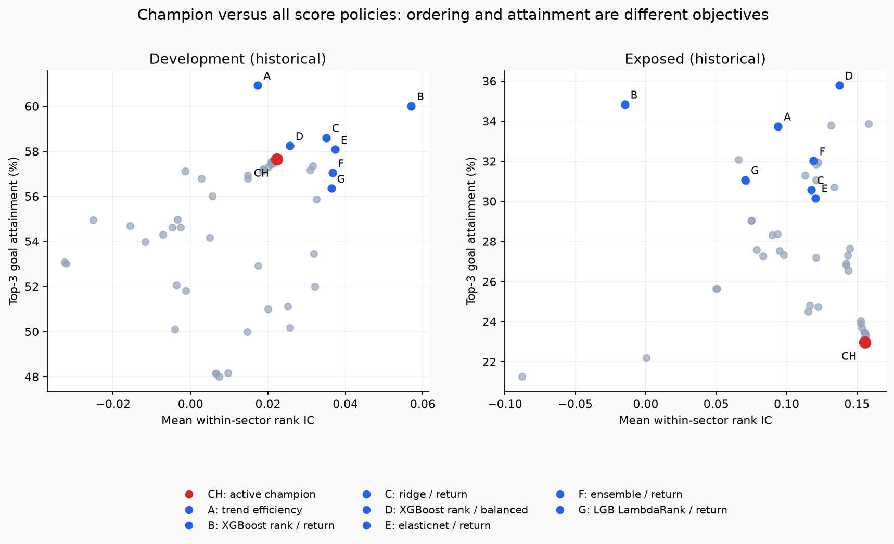
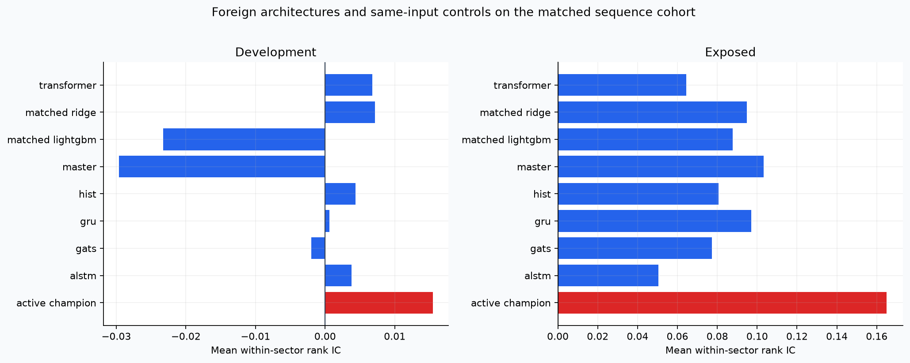

# Champion versus market alternatives: completed retrospective benchmark

Generated 2026-10-31T16:43:24.962392+00:00. NSE/BSE equities only. Research protocol committed before outcome inspection.

**Keep the current champion.** No challenger passed the preregistered development gate combining a material IC or attainment improvement with no worsening in the other primary metric and selected-stock drawdown. This does **not** mean the champion wins every metric. No model was promoted, and neither historical cohort is a fresh holdout.

## What the results mean

Several alternatives improved one objective while weakening another. XGBoost (return) raised development IC from 0.0223 to 0.0570 and Top-3 attainment from 57.64% to 60.01%, but mean selected-stock drawdown worsened from -25.32% to -37.62%. Its already-exposed IC was -0.0149 versus the champion's 0.1554, despite higher goal attainment (34.83% versus 22.96%) and worse selected-stock drawdown (-46.96% versus -31.38%). Higher hit frequency alone would choose a substantially different risk profile.

The balanced tabular ensemble improved exposed attainment to 26.56% and selected-stock drawdown to -30.64%, but its development attainment was 50.17% versus 57.64% for the champion. It therefore did not earn development selection. All six neural adaptations had lower within-sector IC than the matched champion in both periods; this is evidence about these bounded Indian adaptations, not a refutation of the original overseas papers.

Absolute goal probabilities remain unresolved. Champion calibration had Brier 0.2863 versus past-mature climatology 0.2837 in development; exposed Brier 0.2811 was only marginally below climatology 0.2812. This does not meet a requirement to outperform climatology in both periods.

The champion does not dominate all index alternatives. Its global Top-20 portfolio exceeded Nifty500's mean forward-cohort SIP XIRR by 7.05 percentage points in development and 4.34 points in exposed data at 25 bps per buy/sale, on only 14 and 9 matched valid dates. The sector Top-3/equal-sector portfolio instead trailed Nifty500 by 3.43 points in exposed XIRR, on just 3 valid dates. These overlapping, selectively valid provider-price cohorts do not establish unconditional investable superiority or independent alpha.

All 2,039 excluded portfolio observations were blocked for unresolved provider/official corporate actions. Of 4,200 planned model/date/portfolio-policy observations, 2,161 passed those guards and produced 8,644 cost-scenario rows. The exclusions are substantial and can be selective; they are not model execution failures and were not silently dropped and reweighted.

The full table contains 75 named score policies but 73 distinct exact score columns; original/control-original and active-champion/SIP-risk-confirmed are exact aliases. Related policies and overlapping outcome dates are not independent discoveries.

## What was actually tested

- Full cohort: 75 score policies, 3,561 issuers, 28 prediction dates, 9 profiles and 53 sectors; 754,828 guarded outcome rows.
- Nine tabular algorithms each trained on return and balanced objectives; annual mature-label training, fixed whole-query cap, three seeds for stochastic estimators.
- Sequence cohort: 400 matched issuers, six pinned author-code architectures with three seeds, plus two same-input tabular controls. The cohort is an adaptation test, not a reproduction of overseas paper results.
- Fifteen transparent factor policies, prior related-policy variants, neutral/random controls, ten official NSE TRI histories and explicitly price-only BSE500.
- Rank IC, exact tie-aware pair accuracy, NDCG3/10/20, goal attainment, selected-stock XIRR/drawdown/shortfall, loss frequency, cross-asset tail, profile/sector/year/regime/liquidity slices, snapshot stability, mature-only calibration, actual SIP portfolio cashflows and costs.

## Main stock-ranking results

Each row averages sector/profile queries within a date, then dates. XIRR is median selected-stock XIRR within each query, not the XIRR of a combined portfolio. Drawdown is mean selected-asset drawdown; less negative is better. Pair accuracy excludes tied outcomes and gives half credit to tied scores. Constant-score IC is undefined.

| period | model | rank_ic | pair_accuracy | attainment3 | xirr3 | drawdown3 | ndcg3 |
| --- | --- | --- | --- | --- | --- | --- | --- |
| development | factor__trend_efficiency | 0.0173 | 0.5057 | 0.6093 | 0.7764 | -0.3545 | 0.5898 |
| development | ml__xgboost_rankndcg__return | 0.0570 | 0.5194 | 0.6001 | 0.8313 | -0.3762 | 0.5946 |
| development | ml__ridge__return | 0.0350 | 0.5120 | 0.5860 | 0.6832 | -0.3127 | 0.5880 |
| development | ml__xgboost_rankndcg__balanced | 0.0256 | 0.5088 | 0.5824 | 0.7916 | -0.2648 | 0.5965 |
| development | ml__elasticnet__return | 0.0373 | 0.5123 | 0.5808 | 0.6783 | -0.2926 | 0.5845 |
| development | active_champion | 0.0223 | 0.5089 | 0.5764 | 0.3885 | -0.2532 | 0.5399 |
| development | ensemble__return | 0.0366 | 0.5126 | 0.5704 | 0.6577 | -0.3101 | 0.5703 |
| development | ml__lightgbm_lambdarank__return | 0.0363 | 0.5143 | 0.5635 | 0.6170 | -0.3222 | 0.5670 |
| exposed | ml__xgboost_rankndcg__balanced | 0.1374 | 0.5480 | 0.3578 | 0.5589 | -0.3548 | 0.6730 |
| exposed | ml__xgboost_rankndcg__return | -0.0149 | 0.4927 | 0.3483 | 0.2916 | -0.4696 | 0.5977 |
| exposed | factor__trend_efficiency | 0.0940 | 0.5342 | 0.3374 | 0.2679 | -0.4406 | 0.6133 |
| exposed | ensemble__return | 0.1192 | 0.5429 | 0.3201 | 0.3349 | -0.4078 | 0.6198 |
| exposed | ml__lightgbm_lambdarank__return | 0.0706 | 0.5254 | 0.3106 | 0.2467 | -0.4227 | 0.6091 |
| exposed | ml__ridge__return | 0.1174 | 0.5425 | 0.3057 | 0.2123 | -0.3830 | 0.6333 |
| exposed | ml__elasticnet__return | 0.1206 | 0.5431 | 0.3016 | 0.2051 | -0.3805 | 0.6340 |
| exposed | active_champion | 0.1554 | 0.5544 | 0.2296 | 0.0171 | -0.3138 | 0.6305 |

The complete tables include every compared policy, including poor results. The displayed challengers are selected by development results only; their exposed rows are diagnostics, not a fresh contest.

## Foreign architectures on a matched population

| period | model | rank_ic | pair_accuracy | attainment3 | drawdown3 |
| --- | --- | --- | --- | --- | --- |
| development | sequence__matched_ridge | 0.0071 | 0.5027 | 0.5785 | -0.3628 |
| development | active_champion | 0.0155 | 0.5050 | 0.5521 | -0.2865 |
| development | sequence__alstm | 0.0038 | 0.5023 | 0.5413 | -0.3322 |
| development | sequence__gru | 0.0006 | 0.5005 | 0.5405 | -0.3422 |
| development | sequence__matched_lightgbm | -0.0233 | 0.4931 | 0.5282 | -0.3145 |
| development | sequence__gats | -0.0020 | 0.4996 | 0.5273 | -0.3338 |
| development | sequence__hist | 0.0044 | 0.5023 | 0.5264 | -0.3363 |
| development | sequence__transformer | 0.0068 | 0.5023 | 0.5247 | -0.3245 |
| development | sequence__master | -0.0296 | 0.4876 | 0.5076 | -0.3153 |
| exposed | sequence__gru | 0.0969 | 0.5372 | 0.2980 | -0.4060 |
| exposed | sequence__master | 0.1033 | 0.5379 | 0.2935 | -0.3943 |
| exposed | sequence__matched_lightgbm | 0.0878 | 0.5331 | 0.2817 | -0.4108 |
| exposed | sequence__alstm | 0.0506 | 0.5185 | 0.2738 | -0.4093 |
| exposed | sequence__hist | 0.0807 | 0.5307 | 0.2737 | -0.4100 |
| exposed | sequence__matched_ridge | 0.0948 | 0.5382 | 0.2692 | -0.4203 |
| exposed | sequence__gats | 0.0774 | 0.5299 | 0.2684 | -0.4190 |
| exposed | active_champion | 0.1649 | 0.5632 | 0.2648 | -0.3752 |
| exposed | sequence__transformer | 0.0645 | 0.5249 | 0.2475 | -0.4093 |

Same-input Ridge and LightGBM controls use the same short OHLCV/profile/context representation. Comparisons with the full-feature champion use matched issuers but different feature sets. HIST concepts are retrospective sectors; no historical supply-chain graph was fabricated.

## Selection uncertainty and decision

Selection uses development only and is written before exposed metric computation. Both365- and730-day circular date-block bootstraps use4000 resamples and a simultaneous maximum over all candidates within the cohort family. The familywise hurdle is incremental relative to the frozen champion, not an absolute minimum acceptable IC. Neutral undefined IC is excluded from the IC family only. The final diagnostic additionally uses97.5%maximum floors for each of the two primary endpoints, conservatively controlling the either-endpoint selection rule; per-metric95%floors remain reported. Block lengths exceeding available temporal history are unavailable, never zero uncertainty.

| model | metric | block_days | delta | familywise_noise_floor | simultaneous_lower95 |
| --- | --- | --- | --- | --- | --- |
| factor__trend_efficiency | rank_ic | 365 | -0.0050 | 0.1125 | -0.1174 |
| ml__xgboost_rankndcg__return | rank_ic | 365 | 0.0347 | 0.1125 | -0.0778 |
| factor__trend_efficiency | rank_ic | 730 | -0.0050 | 0.1084 | -0.1134 |
| ml__xgboost_rankndcg__return | rank_ic | 730 | 0.0347 | 0.1084 | -0.0737 |
| factor__trend_efficiency | attainment3 | 365 | 0.0328 | 0.0854 | -0.0526 |
| ml__xgboost_rankndcg__return | attainment3 | 365 | 0.0237 | 0.0854 | -0.0618 |
| factor__trend_efficiency | attainment3 | 730 | 0.0328 | 0.0748 | -0.0420 |
| ml__xgboost_rankndcg__return | attainment3 | 730 | 0.0237 | 0.0748 | -0.0512 |
| factor__trend_efficiency | drawdown3 | 365 | -0.1012 | 0.0359 | -0.1371 |
| ml__xgboost_rankndcg__return | drawdown3 | 365 | -0.1230 | 0.0359 | -0.1589 |
| factor__trend_efficiency | drawdown3 | 730 | -0.1012 | 0.0310 | -0.1322 |
| ml__xgboost_rankndcg__return | drawdown3 | 730 | -0.1230 | 0.0310 | -0.1540 |

Risk noninferiority is a point-estimate gate, not a powered drawdown noninferiority trial. There are few independent decision dates and overlapping12-month outcomes. No new strategy was deployed.

## Investor cashflows and official indices

75 score policies were simulated on base7500 with global top20 and sector top3/equal-sector capital policies. Planned portfolio observations before four cost scenarios: 4,200. Completed cost rows: 8,644; failure records: 2,039. Missing selected histories and unresolved corporate actions block entire observations. Failures are evidence limits rather than zero returns.

Stock portfolio paths use recovered provider Adj Close with fractional units; official NSE indices use gross TRI. Costs of0/10/25/50bps apply to each purchase and the terminal sale. These are research proxies, not certified fund NAVs or exact Indian tax/impact estimates. BSE500 price-only results exclude dividends. Index prelaunch histories are separately labelled backfilled; live-only summaries are provided. Weekly contributions that cannot execute before the endpoint are flagged.

Champion minus Nifty500 on matched valid dates at 25 bps per buy/sale:

| period | policy | matched_dates | xirr_delta | goal_hit_delta | tw_max_drawdown_delta | tw_sharpe_rf0_delta |
| --- | --- | --- | --- | --- | --- | --- |
| development | global_top20 | 14 | 0.0705 | 0.0714 | 0.0073 | 0.4020 |
| exposed | global_top20 | 9 | 0.0434 | 0.1111 | -0.0184 | 0.1799 |
| development | sector_top3_equal_sector | 5 | 0.1761 | 0.4000 | 0.0134 | 1.1573 |
| exposed | sector_top3_equal_sector | 3 | -0.0343 | 0.0000 | -0.0363 | -0.1417 |

The mean XIRR across overlapping forward cohorts is not a chainable strategy CAGR. Daily flow-adjusted portfolio drawdown is separate from individual-stock drawdown. Risk ratios labelled RF0 use zero risk-free return; IIMA four-factor OLS exposures are descriptive and use its separate RF series. The factor library ends December2025 and can be retrospectively revised; insufficient matched daily history is flagged.

## Calibration and product stability

| period | model | brier | climatology_brier | logloss | ece10 |
| --- | --- | --- | --- | --- | --- |
| development | active_champion | 0.2863 | 0.2837 | 0.7771 | 0.1843 |
| development | factor__trend_efficiency | 0.2839 | 0.2837 | 0.7696 | 0.1789 |
| development | ml__ridge__return | 0.2918 | 0.2837 | 0.7998 | 0.1861 |
| development | ml__xgboost_rankndcg__balanced | 0.2888 | 0.2837 | 0.7852 | 0.1824 |
| development | ml__xgboost_rankndcg__return | 0.2921 | 0.2837 | 0.7875 | 0.2025 |
| exposed | active_champion | 0.2811 | 0.2812 | 0.7559 | 0.3265 |
| exposed | factor__trend_efficiency | 0.2805 | 0.2812 | 0.7548 | 0.3272 |
| exposed | ml__ridge__return | 0.2803 | 0.2812 | 0.7544 | 0.3265 |
| exposed | ml__xgboost_rankndcg__balanced | 0.2818 | 0.2812 | 0.7573 | 0.3269 |
| exposed | ml__xgboost_rankndcg__return | 0.2690 | 0.2812 | 0.7316 | 0.3112 |

Calibrations use earlier out-of-time scores and outcomes matured strictly before the prediction date, at least two historical prediction dates and both labels. No raw rank is presented as a probability. Later exposed calibrations can include earlier exposed outcomes once mature under the fixed prequential rule. ECE uses fixed ten bins and is descriptive.

| period | model | top3_churn | kendall_tau |
| --- | --- | --- | --- |
| development | active_champion | 0.3774 | 0.6095 |
| development | factor__trend_efficiency | 0.5343 | 0.3073 |
| development | ml__ridge__return | 0.6059 | 0.4428 |
| development | ml__xgboost_rankndcg__balanced | 0.4230 | 0.5561 |
| development | ml__xgboost_rankndcg__return | 0.4874 | 0.5322 |
| exposed | active_champion | 0.2967 | 0.6896 |
| exposed | factor__trend_efficiency | 0.3549 | 0.5244 |
| exposed | ml__ridge__return | 0.4782 | 0.5159 |
| exposed | ml__xgboost_rankndcg__balanced | 0.3549 | 0.6079 |
| exposed | ml__xgboost_rankndcg__return | 0.3242 | 0.6171 |

Stability ranks the full feature-available cohort, including stocks without evaluable future labels. It measures consecutive available snapshots, not daily champion replay or evidence that a particular hysteresis margin passes its earlier leader-lag gate.

## Coverage, cost and reproducibility

| family | model | distinct_recorded_fits | seconds | max_train_rows |
| --- | --- | --- | --- | --- |
| sequence | alstm | 18 | 315.0544 | 83063 |
| sequence | gats | 18 | 1451.0276 | 83063 |
| sequence | gru | 18 | 325.0350 | 83063 |
| sequence | hist | 18 | 3689.3148 | 83063 |
| sequence | master | 18 | 4590.5234 | 83063 |
| sequence | matched_lightgbm | 6 | nan | 83063 |
| sequence | matched_ridge | 6 | nan | 83063 |
| sequence | transformer | 18 | 702.7831 | 83063 |
| tabular | catboost_yetirank | 36 | 3306.9287 | 120000 |
| tabular | elasticnet | 12 | 24.0553 | 120000 |
| tabular | extra_trees | 36 | 2275.2037 | 120000 |
| tabular | hist_gradient_boosting | 12 | 576.5554 | 120000 |
| tabular | lightgbm_lambdarank | 12 | 98.7053 | 120000 |
| tabular | lightgbm_regression | 12 | 57.1247 | 120000 |
| tabular | random_forest | 36 | 8632.6121 | 120000 |
| tabular | ridge | 12 | 9.5190 | 120000 |
| tabular | xgboost_rankndcg | 12 | 217.5524 | 120000 |

Runtime is observed shared-machine time, not a hardware-normalized speed contest. Fit receipts record exact seeds, training endpoints, key hashes and parameters. Saved-weight inference is checked against original valid-row predictions with float32 numerical tolerance; source panels, weights and raw provider/index caches remain local. The public evidence bundle contains protocols, code, licences, acquisition hashes, audit receipts and aggregate/pairwise results. External data providers and pinned source snapshots are required to reconstruct the full local panel.

See [literature review](champion_vs_market_literature_20261031.md), [56 primary references](../literature/20261031/REFERENCES.md), the experiment README and evidence manifest. Commercial scoring platforms without matched historical score archives remain **untested**, not defeated.

## Agreement, personalization and excluded-coverage diagnostics

Fixed equal-weight percentile ensembles combine all9return models, all9balanced models, or all6neural networks. Percentile normalization uses the full feature cohort before any outcome filter. They enter the same development selection and familywise maximum as the individual challengers. Disagreement averages the two objectives within each tabular algorithm before measuring dispersion across algorithms. No confidence gate is activated.

| period | retained_fraction | pair_accuracy | rank_ic | attainment3 | queries |
| --- | --- | --- | --- | --- | --- |
| development | 0.2500 | 0.5090 | 0.0239 | 0.5528 | 4378 |
| development | 0.5000 | 0.5176 | 0.0468 | 0.5736 | 6505 |
| development | 0.7500 | 0.5081 | 0.0189 | 0.5719 | 7287 |
| development | 1.0000 | 0.5097 | 0.0244 | 0.5770 | 7419 |
| exposed | 0.2500 | 0.5646 | 0.1779 | 0.2829 | 3627 |
| exposed | 0.5000 | 0.5539 | 0.1493 | 0.2420 | 5025 |
| exposed | 0.7500 | 0.5527 | 0.1480 | 0.2269 | 5654 |
| exposed | 1.0000 | 0.5544 | 0.1554 | 0.2296 | 5700 |

Coverage curves are conditional on the retained stocks and available queries; they are not a free improvement at unchanged coverage. Tiny retained groups are unavailable, and the query counts must be read with accuracy.

| profile | model | kendall_tau | top20_overlap | mean_absolute_percentile_change |
| --- | --- | --- | --- | --- |
| amount1000 | active_champion | 0.9363 | 0.9321 | 0.0207 |
| amount1000 | ensemble__balanced | 1.0000 | 1.0000 | 0.0000 |
| amount50000 | active_champion | 0.9422 | 0.9143 | 0.0187 |
| amount50000 | ensemble__balanced | 1.0000 | 1.0000 | 0.0000 |
| target10 | active_champion | 0.9942 | 0.9857 | 0.0020 |
| target10 | ensemble__balanced | 1.0000 | 1.0000 | 0.0000 |
| target30 | active_champion | 0.9945 | 0.9768 | 0.0019 |
| target30 | ensemble__balanced | 1.0000 | 1.0000 | 0.0000 |

Target sensitivity is observed rank change, not proof of calibrated goal probability or investor utility. A profile can change labels/cashflows while leaving a price-only model ordering unchanged.

| period | coverage_group | rank_ic | pair_accuracy | attainment3 | drawdown3 | rows | queries |
| --- | --- | --- | --- | --- | --- | --- | --- |
| development | classified_at_least5 | 0.0162 | 0.5055 | 0.5509 | -0.1940 | 415312 | 144 |
| development | classified_fewer_than5 | -0.0227 | 0.4980 | 0.5417 | -0.2759 | 2177 | 144 |
| development | unclassified | 0.0127 | 0.5049 | 0.3333 | -0.2787 | 7978 | 144 |
| exposed | classified_at_least5 | 0.1801 | 0.5600 | 0.2191 | -0.2116 | 339516 | 108 |
| exposed | classified_fewer_than5 | 0.0720 | 0.5231 | 0.4537 | -0.2931 | 1198 | 108 |
| exposed | unclassified | 0.1306 | 0.5446 | 0.1605 | -0.3290 | 6420 | 108 |

Unclassified and tiny-sector rows are pooled across their coverage group within date/profile for this supplementary cross-sectional diagnostic. They do not qualify as within-sector rank validation or promotion evidence. Primary full-cohort sector queries retain at least5matched stocks: 13119queries/754828rows. Sequence primary support after matching and the same5-stock rule: 5602queries/74029rows.

## Figures

## Material limits

- Current-survivor identities, retrospective sectors and incomplete historical delisting/terminal-price recovery remain. This is not survivorship-free validation. All scored outcomes use a12-month forward horizon; investor profiles vary amount, interval, target and history lookback, not the forward holding horizon.
-2024-2025 was already exposed in earlier research; there is no fresh historical holdout here. The prospective ledger still needs eligible fresh champion inputs.
- Fundamentals/quality/value are represented by real index investment comparators, not a fabricated point-in-time stock accounting panel.
- A small fixed-budget foreign-model adaptation does not bound the best possible overseas architecture performance. Reviewed but unexecuted architectures are explicitly listed in the literature report.
- Missing/blocked portfolio observations can be selective. Only common valid dates are compared, with their counts shown; these results cannot establish unconditional investable superiority.
- No claim of beating every Indian commercial ranking service is supported by these data.
