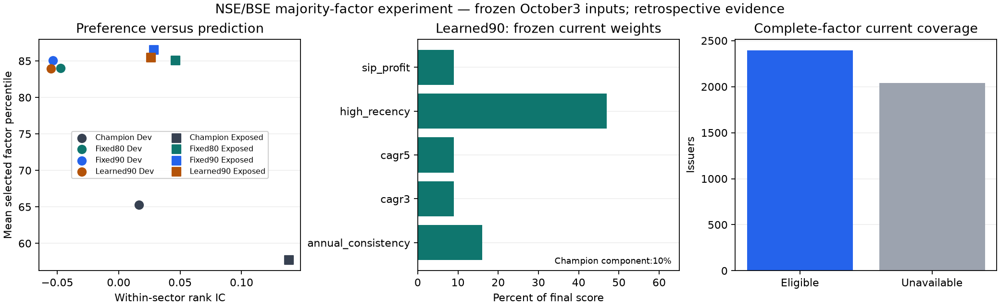

# Majority-factor ranking experiment

Frozen family before new scoring: commit5086bad3; source-support repair retains earlier mature rows without relaxing cutoffs. All history was previously exposed. No production replacement or fresh-input claim.

## What was built

A transparent weighted-percentile ranker and a positive Ridge adaptation. Fixed90 gives18%each to annual consistency, 3-year CAGR, 5-year CAGR, recorded-high recency and historical whole-share SIP profit, plus10% to champion. Fixed80 gives16%each and20% to champion. Learned90 assigns90% to the five factors, each at least 9% of final score, and10% to champion. These are genuine score coefficients, not accuracy percentages or paper-prescribed optimal weights. The five-year annual block needs six year-end price boundaries. No current fundamentals were backcast.

Positive Ridge constrains fitted coefficient signs; explicit normalization/floors enforce our weight budget. Monotonic trees alone do not guarantee this budget. Primary references: [scikit-learn Ridge](https://scikit-learn.org/stable/modules/generated/sklearn.linear_model.Ridge.html), [LightGBM constraints](https://lightgbm.readthedocs.io/en/v4.6.0/Parameters.html).

## Decision

Development-selected candidate: **NONE**. Selection maximises development alignment gain subject to >=2 percentile-point alignment gain, <=0.01 IC loss, <=2 ppselected-stock drawdown worsening, and>=10%changed sectors. This is an operational preference gate, not statistical proof. Exposed diagnostics do not change selection. Production promotion remains **false**.

## Matched-cohort results

Alignment is mean selected factor percentile, higher preferred; its improvement is partly mechanical and not predictive accuracy. Changed is mean fraction of sectorTop-3 sets differing from champion. DD is selected-stock drawdown, less negative preferred. All model comparisons use the same complete-factor cohort; these numbers must not be compared directly with the earlier75-policy full-universe averages.

| model | period | alignment | changed | rank_ic | attainment3 | drawdown3 |
| --- | --- | --- | --- | --- | --- | --- |
| active_champion | development | 65.26% | 0.00% | 0.0165 | 59.57% | -25.61% |
| factor80_fixed | development | 83.99% | 90.83% | -0.0474 | 55.46% | -31.38% |
| factor90_fixed | development | 85.06% | 93.49% | -0.0534 | 54.32% | -32.51% |
| factor90_learned | development | 83.98% | 92.88% | -0.0550 | 54.80% | -31.22% |
| active_champion | exposed | 57.69% | 0.00% | 0.1384 | 22.16% | -30.91% |
| factor80_fixed | exposed | 85.06% | 98.62% | 0.0461 | 28.21% | -40.60% |
| factor90_fixed | exposed | 86.54% | 98.97% | 0.0288 | 27.83% | -42.66% |
| factor90_learned | exposed | 85.44% | 98.97% | 0.0262 | 27.06% | -41.76% |

## Current coverage and actual stock replacements

2396/4436 issuers have the complete required factor evidence. Others have an unavailable lens, not fabricated factor values or rescaled weights. Production champion coverage is unchanged. Inputs remain dated3 October2026.

| model | sectors | changed_sectors | shared_slots | slots |
| --- | --- | --- | --- | --- |
| factor80_fixed | 50 | 46 | 54 | 150 |
| factor90_fixed | 50 | 46 | 49 | 150 |
| factor90_learned | 50 | 46 | 53 | 150 |

## Final learned-factor coefficients

| factor | final_score_share |
| --- | --- |
| annual_consistency | 16.00% |
| cagr3 | 9.00% |
| cagr5 | 9.00% |
| high_recency | 47.00% |
| sip_profit | 9.00% |
| champion | 10.00% |

## Portfolio cashflow diagnostic

Champion-relative mean SIP XIRR and cashflow-adjusted drawdown differences at25 bps per buy/final sale. Fractional-unit provider AdjClose proxy, 7500 per30 days, 12 months. Matched/planned date counts matter. Missing selected paths/actions block the entire observation; no reweighting. These overlapping cohort means are not a chainable strategy CAGR or certified executable whole-share returns. No sparse positive result overrides selection.

| model | policy | period | matched_dates | planned_dates | xirr_delta | drawdown_delta |
| --- | --- | --- | --- | --- | --- | --- |
| factor80_fixed | global_top20 | development | 13 | 16 | -8.67 pp | -5.85 pp |
| factor90_fixed | global_top20 | development | 13 | 16 | -6.65 pp | -7.40 pp |
| factor90_learned | global_top20 | development | 12 | 16 | -12.25 pp | -6.25 pp |
| factor80_fixed | global_top20 | exposed | 10 | 12 | +6.23 pp | -5.80 pp |
| factor90_fixed | global_top20 | exposed | 11 | 12 | +1.91 pp | -5.53 pp |
| factor90_learned | global_top20 | exposed | 11 | 12 | +2.15 pp | -3.07 pp |
| factor80_fixed | sector_top3_equal_sector | development | 5 | 16 | -8.12 pp | -5.42 pp |
| factor90_fixed | sector_top3_equal_sector | development | 5 | 16 | -9.05 pp | -5.47 pp |
| factor90_learned | sector_top3_equal_sector | development | 5 | 16 | -8.58 pp | -4.80 pp |
| factor80_fixed | sector_top3_equal_sector | exposed | 3 | 12 | -0.83 pp | -4.83 pp |
| factor90_fixed | sector_top3_equal_sector | exposed | 2 | 12 | +1.46 pp | -4.63 pp |
| factor90_learned | sector_top3_equal_sector | exposed | 3 | 12 | -1.21 pp | -5.21 pp |

## Integrity and uncertainty

Seven learned fits record strict mature endpoints before each fold cutoff. Factor scores use full feature cohorts before outcome filtering. Missing selected future outcomes block Top-3 metrics for every compared model; no reselection after removing unknown outcomes. The first attempted fit correctly stopped when an initial left join lost earlier training rows; the fix retains those source rows and keeps missing champion scores missing. Failed logs/checkpoint are preserved locally.

uncertainty.csv reports4000 paired365/730 day circular-block resamples with per-metric95%simultaneous bounds across the three candidates. These bounds do not jointly cover all metrics or turn already-exposed history into a holdout. Unsupported block spans are unavailable. Coverage/support tables and all fitted weights are included.

## Limits and delivery

One base7500 profile only. Current-survivor identities, retrospective sectors, provider-adjusted historical prices and incomplete corporate-action/fundamental certification remain. Fewer complete-history stocks may be a selective universe; champion is restricted identically for comparison. Five annual returns and3-year/5-year CAGR overlap. Recorded closing high is available-history high, not certified lifetime ATH. Absolute goal probabilities and commercial-platform superiority are untested here. Fresh daily champion inputs remain unresolved.

