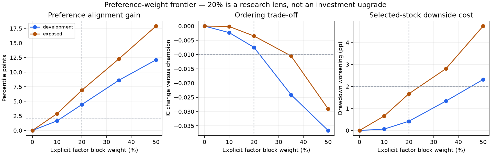

# A substantial professor-factor preference model: completed tests

Built and tested seven candidate specifications. **Selected operational preference lens: factor20_fixed.** Production champion unchanged; no fresh validation.

## Finding

The first 80/90 percent majority-factor family failed the fixed development accuracy/risk limits. Its roughly 19–20 percentile-point alignment gain came with negative development IC and approximately 6–7 pp worse selected-stock drawdown. Positive Ridge with factor-weight floors did not rescue it. Forcing a majority weight is not supported by these data.

A separate 10/20/35/50 percent curve was registered after those development findings and before calculating its own outcomes. This follow-up is exploratory overall; all historical periods were already exposed. The original family and its failed selection remain intact. No extra grid expansion or exposed-based retuning followed.

The selected lens allocates **20% of the score** to the professor-related factor block and **80% to the existing champion percentile**. Each of the five factor blocks receives **4% of the final score**. This is a fixed, inspectable score allocation, not a claimed accuracy improvement or causal attribution.

The five blocks are five-completed-year annual-return consistency, 3-year CAGR, 5-year CAGR, inverse recorded-high age, and historical whole-share SIP profit. The full five-year return block is reconstructed from dated provider Close prices; missing history is not replaced by one-year momentum. No point-in-time fundamental panel was fabricated.

## Matched results

Alignment is intentional preference fit and partly circular, not predictive accuracy. Changed is the mean fraction of sectors whose Top-3 set differs. DD is average selected-stock drawdown. Same complete-factor stocks and dates for all candidates; these are different support from the earlier75-model report.

| model | period | alignment | changed | rank_ic | attainment3 | drawdown3 |
| --- | --- | --- | --- | --- | --- | --- |
| active_champion | development | 65.26% | 0.00% | 0.0165 | 59.74% | -25.58% |
| factor10_fixed | development | 66.92% | 13.20% | 0.0142 | 59.30% | -25.64% |
| factor20_fixed | development | 69.71% | 31.93% | 0.0091 | 59.21% | -26.00% |
| factor35_fixed | development | 73.88% | 56.51% | -0.0076 | 57.78% | -26.92% |
| factor50_fixed | development | 77.38% | 71.96% | -0.0201 | 57.10% | -27.89% |
| active_champion | exposed | 57.69% | 0.00% | 0.1384 | 22.16% | -30.85% |
| factor10_fixed | exposed | 60.59% | 22.29% | 0.1383 | 22.47% | -31.51% |
| factor20_fixed | exposed | 64.59% | 42.49% | 0.1349 | 23.73% | -32.52% |
| factor35_fixed | exposed | 69.97% | 67.87% | 0.1279 | 25.39% | -33.66% |
| factor50_fixed | exposed | 75.60% | 85.49% | 0.1094 | 26.66% | -35.60% |

The development rule required >=2 percentile-point alignment gain, IC loss<=0.01, drawdown worsening<=2 pp, and>=10%changed sector sets. Ten percent did not meet the alignment threshold;35/50 percent lost too much ordering accuracy. The20 percent model was the only passer. Exposed results are diagnostics, not the selection reason. These point limits are not proof of statistical noninferiority.

**Investment replacement is not established:** the20 percent globalTop-20 portfolio lost2.22 pp mean XIRR in development on 15/16 matched dates, exceeding the earlier shadow plan's2 pp loss limit. Its exposed+9.13 pp came from only 7/12 dates; that selective result is not promotion evidence. SectorTop-3 has still fewer valid dates and worse exposed portfolio drawdown. Preference fit does not make this a better investment model.

## Frozen current coverage and stock changes

2396/4436 issuers have the complete required factor evidence on 3 October2026. Others retain an explicitly unavailable lens. The production champion continues separately; no complete-market or fresh-current claim.

| model | sectors | changed_sectors | shared_slots | slots |
| --- | --- | --- | --- | --- |
| factor10_fixed | 50 | 10 | 140 | 150 |
| factor20_fixed | 50 | 24 | 124 | 150 |
| factor35_fixed | 50 | 36 | 103 | 150 |
| factor50_fixed | 50 | 39 | 89 | 150 |

## Selected-lens portfolio trade-offs

Differences from champion at25 bps each buy/final sale, on paired valid dates. Provider AdjClose fractional-unit SIP proxy, not certified executable whole-share NAV. Missing paths and unresolved actions block the entire observation. Read matched/planned counts; a mean across overlapping cohorts is not a continuous strategy CAGR. These diagnostics cannot overrule the development lock.

| model | policy | period | matched_dates | planned_dates | xirr_delta | drawdown_delta |
| --- | --- | --- | --- | --- | --- | --- |
| factor20_fixed | global_top20 | development | 15 | 16 | -2.22 pp | -1.03 pp |
| factor20_fixed | global_top20 | exposed | 7 | 12 | +9.13 pp | -1.49 pp |
| factor20_fixed | sector_top3_equal_sector | development | 9 | 16 | -2.85 pp | -0.61 pp |
| factor20_fixed | sector_top3_equal_sector | exposed | 5 | 12 | +0.68 pp | -2.42 pp |

## Implementation and evidence

Runtime function: `stock_research.professor_factor_model.preference_lens`. Use `normalize_factors` on causally prepared complete factor inputs. The exported package fixes weights, eligibility, source date and selection provenance. Cached current rankings are supplied; no model defaults were changed. Seven annual/current positive-Ridge fits were tested for the majority family; the bounded curve requires no new fitting. The model code is a thin open-source pandas/NumPy/scikit-learn adaptation, not a claimed pretrained Indian champion.

`uncertainty.csv` reports4000 paired calendar-block resamples at365/730 days, per-metric95%simultaneous candidate bounds. Missing temporal support is unavailable. This is not joint coverage across every metric or a fresh holdout. Complete query support, portfolio failures, weights and source hashes are retained.

## Limits

Only base7500 profile and12-month outcomes. Survivor identities, retrospective sectors, provider price revisions, selective complete-history coverage and unresolved corporate-action certification remain. The price/SIP factors overlap and exclude a validated fundamental-screening model. Higher historical-factor alignment does not establish higher future returns. The fresh daily-input pipeline remains unverified. The selected lens is ready for separately registered prospective testing once eligible inputs exist; the old small-SIP-tilt stream is not silently repurposed.

See [majority-family failures](professor_majority_20261031.md), [initial protocol](../protocols/professor_majority_20261031.json), [separate bounded-curve protocol](../protocols/professor_weight_curve_20261031.json), and [Ridge documentation](https://scikit-learn.org/stable/modules/generated/sklearn.linear_model.Ridge.html).

The current Top-3 counts use50 complete-factor sectors, not the previous small-tilt analysis's57 sector universe. Top-3 outcome support also differs between separately frozen families because an unknown selected outcome blocks the entire family query; compare within each table. Verification:19 relevant tests passed, all seven Ridge fit endpoint cutoffs audited, no production scoring changes.

