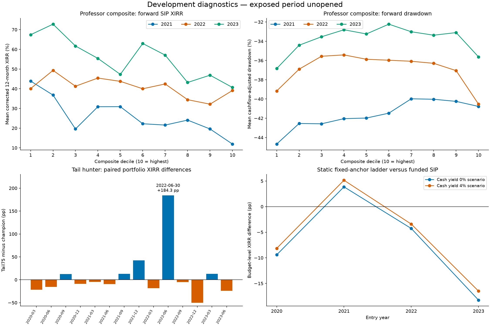

# Sir-framework extensions and tail concentration audit

All five fixed extension tests remain **not confirmed** under their registered
rules. This means the candidates did not earn adoption; it does not refute the
general hypotheses. The earlier quarterly timing sign flips are likewise weak
evidence with roughly four dates per year, and were not tests of a daily ladder.
Exposed-period performance remains unopened. Champion, model weights and both
prospective-ledger streams are unchanged.

| test | decision | reason |
| --- | --- | --- |
| Tail concentration | Not confirmed | Negative median, winsorized and worst exclusion means |
| 30% target | Not confirmed | Positive high-target increment in 1/3 years |
| Composite sweet spot | Not confirmed | Fixed shape qualifies in 0/3 years |
| CAGR/recent-high gate | Not confirmed | IC delta -0.03868; portfolio drawdown delta -0.163pp |
| Static fixed-anchor ladder | Not confirmed | Lower pooled budget XIRR; yearly-sign rule fails |
| ATH-cross increment | Not confirmed | IC increment +0.000174; hurdle 0.010135 |

## 1. The tail gain is concentrated

Reconstructed the exact previous 14 matched portfolio dates, with original
100bp-per-side cashflows. The XIRR mean agrees with the published comparison to
less than 1e-9. Equal-weighted stock terminal wealth reproduces the two portfolio
XIRRs, allowing security deletions without incorrectly adding individual XIRRs.

| Paired portfolio XIRR statistic | Tail75 minus champion, pp |
| --- | ---: |
| Mean | 7.688 |
| Median date | -7.068 |
| 10%-per-tail winsorized date mean | -0.579 |
| Worst leave-one-date-out mean | -5.900 |
| Worst leave-one-security-out mean | -8.293 |
| 365-day block lower 95% bound | -20.188 |
| 365-day block upper 95% bound | 29.361 |

The best date is **2022-06-30**, not a 2020 entry. It contributes
**171.3%** of the net sum of date-level XIRR
increments. The largest single-security contribution is
**275.4%** of net additive terminal-wealth
gain. Shares exceed 100% because other contributions offset them negatively.
The stock share is NOT an additive attribution of XIRR. Every security deletion
replaces its allocation with idle cash in both strategies, with no replacement
stock or reweighting. There were 226 distinct securities in
the union. Identities stay local.

Distribution of selected individual-stock XIRRs, including repeated cohort
observations (different from portfolio XIRR):

| model | mean | median |
| --- | --- | --- |
| champion | 40.012 | 24.565 |
| tail75 | 60.791 | 14.380 |

The original positive mean therefore does not pass the concentration screen.
Its nominal centered block-bootstrap p is 0.2524; the documented
attempt adjustment below gives 1.000. None is fresh validation.

## 2. Running variant count

The persistent [research variant ledger](../research_variant_ledger.csv) now has
**299 documented scoped attempts**: 279
configuration records plus 20 questions/policy scenarios
registered for this round. It includes preserved 120-configuration ATH refinement,
the 75-policy benchmark and other catalogued tournaments and factor families.
It is not a count of 299 independent models. Cross-round aliases and repeated
evaluations are retained conservatively; annual fits and seeds are not each a
new strategy. Older manual/adaptive work is not exhaustively catalogued, so the
total is incomplete. New IDs append to the ledger rather than erase failed trials.

We report a nominal block-bootstrap p and min(1,p×documented attempts). This only
adjusts within the documented history; it does not repair adaptive research or
certify an all-history false-positive rate. Both the tail gain and ATH increment
have documented-adjusted p=1. No development win is promoted on this evidence.

## 3. Thirty-percent goal and the saved nine profiles

The primary corrected-label test covers target10, base7500 (target20) and target30.
They share amount, contribution schedule, lookback and horizon. We use the frozen
base7500 tail order and archived profile-specific champion score order, on the
same feature cohort. These archived raw profile scores differ from the normalized
champion reference used in the earlier concentration table, so their headline
results should not be directly equated. Global Top-20 selections precede outcome
filtering; any unknown selected label blocks the date for both.

Annual Top20 attainment differences, tail minus profile champion, in pp:

| profile_name | year | delta | dates |
| --- | --- | --- | --- |
| base7500 | 2020 | -2.500 | 4 |
| base7500 | 2021 | 10.000 | 3 |
| base7500 | 2022 | -20.000 | 4 |
| base7500 | 2023 | -22.500 | 2 |
| target10 | 2020 | -2.500 | 4 |
| target10 | 2021 | 8.333 | 3 |
| target10 | 2022 | -28.750 | 4 |
| target10 | 2023 | -32.500 | 2 |
| target30 | 2020 | 3.750 | 4 |
| target30 | 2021 | 11.667 | 3 |
| target30 | 2022 | -5.000 | 4 |
| target30 | 2023 | -10.000 | 2 |

At the 30% goal, the increment is positive in only **1
of 2021/22/23**, short of the required two. The pooled 2021–23 high-target difference
is **-0.556pp**. Each reported primary year has
at least two valid dates; coverage CSVs retain unknown scores/outcomes.
Changing a goal threshold can change a hit statistic without changing a single
rank. This frozen tail model is not a newly learned goal-conditional ranker, and
this test does not establish genuine target-dependent personalization.

All nine saved profiles were also checked as a **legacy cross-profile transfer
diagnostic**. Their old whole-share/same-close outcomes are not corrected next-open
evidence; amount, lookback and weekly/quarterly settings were not relabeled with
base7500 outcomes. Pooled legacy hit differences in pp, with valid dates:

| profile_name | valid_dates | legacy_hit_delta |
| --- | --- | --- |
| amount1000 | 7 | -10.714 |
| amount50000 | 9 | -8.333 |
| base7500 | 7 | -9.286 |
| lookback12 | 7 | -6.429 |
| lookback60 | 8 | -9.375 |
| quarterly | 6 | -8.333 |
| target10 | 7 | -11.429 |
| target30 | 7 | 1.429 |
| weekly | 7 | -12.143 |

No high-target model was fitted or selected after these results.

## 4. Dose response: no confirmed middle band

Composite = equal mean of the five original professor-factor percentiles.
Global deciles are assigned from features before filtering future outcomes, with
deterministic ISIN tie breaks. Outcomes are corrected 12-month SIP XIRR and
cashflow-adjusted stock drawdown. The chart displays 2021–23; 2020 is context.
The one fixed sweet-spot hypothesis was deciles 6–9 beating both decile 10 and
deciles 1–5, without worse drawdown than 10. No alternative band was selected.

Return and drawdown contrasts in pp:

| year | middle_minus_top | middle_minus_low | middle_dd_minus_top |
| --- | --- | --- | --- |
| 2020 | 37.813 | -24.818 | -4.102 |
| 2021 | 9.943 | -10.546 | 0.342 |
| 2022 | -1.865 | -6.717 | 4.189 |
| 2023 | 11.877 | -8.393 | 2.699 |

The middle beats the highest decile in 2021 and 2023, but trails the lower five
deciles in all three primary years. The complete fixed shape qualifies in
**0/3 years**. This does not justify inverting the score or
choosing another interval after inspecting the curve.

## 5. Sir factors as a gate

Require 3Y and 5Y CAGR of at least 10%, plus a recorded high within 365 days, then keep
champion order inside passers. For the same-universe IC diagnostic, passers sort
ahead of nonpassers while each group's internal champion order is unchanged.
Simply reporting conditional IC inside the gate would be a tautological ordering
comparison, so it is not presented as a new ranker win.

Mean IC increment is **-0.03868**, worse than the allowed -0.01.
On **16** matched global Top-20 actual SIP portfolio dates,
drawdown delta is **-0.163pp** (negative means worse).
Average selected sector Top-3 stock drawdown delta is
**-3.161pp**. Both parts of the gate rule fail.

## 6. User-approved static fixed-anchor ladder

**Static fixed-anchor ladder, not the daily-reset ladder.** Capital INR 90,000 is
available upfront to both policies. Stocks are the same gated-champion Top-20,
with equal initial capital allocations, and no replacement names. Anchor each
stock to its split-adjusted provider recorded closing high through entry; freeze
that anchor. Trigger once at closes 10/15/20/25/30/35/40% below it, spending
10/5/20/10/30/15/10% of original principal at the following observed open. A stock
already below levels at entry queues those tranches for the first following open.
There is no stop-loss, anchor reset, or use of future highs.

The comparator deploys the same upfront budget in 12 equal real-calendar-month SIP
installments over 12 months. Both pay 100bp per buy/sell, retain unused cash and
use identical cash treatment. Budget XIRR has the full original capital in the
denominator. Cash earns either 0% or a **fixed 4% annual scenario**, compounded by
actual days. The latter is an assumption, not an observed liquid-fund history,
fund recommendation or guaranteed yield. Price-only Open/Close paths omit
dividends and tax symmetrically; fractional shares keep this a research proxy.

The tranche percentages and levels match the preserved workbook formula audit.
The exported sixth-tranche quantity formula references blank A2 instead of its
allocation cell; this proxy follows the user's explicitly approved 15% allocation,
not that exported zero. The original attachment paths are unavailable; the
preserved audit and the user's exact approved rules supply the specification.
Unresolved action windows block the whole original portfolio and stay blocked
in every cash/liquidity scope. Unknown opens, zero-volume execution or over 7-day gaps
are not silently converted to idle-cash successes.

Ladder-minus-funded-SIP differences in pp, 16 valid dates per scenario:

| liquidity_scope | cash_rate | dates | mean | median | winsorized_mean | lodo_min | mean_dd_delta | pass_fixed_rule |
| --- | --- | --- | --- | --- | --- | --- | --- | --- |
| all | 0.0 | 16 | -7.019 | -5.958 | -7.730 | -8.844 | 4.560 | False |
| all | 0.04 | 16 | -5.724 | -4.573 | -6.334 | -7.456 | 4.736 | False |
| exclude_bottom_quintile | 0.0 | 16 | -7.019 | -5.958 | -7.730 | -8.844 | 4.560 | False |
| exclude_bottom_quintile | 0.04 | 16 | -5.724 | -4.573 | -6.334 | -7.456 | 4.736 | False |

Positive drawdown delta means less loss. Ladder mean budget XIRR trails SIP at
both cash yields, although drawdown improves. It beats SIP in 2021 but not 2020,
2022 or 2023. The registered requirement was a positive sign in every development
year, plus positive winsorized and leave-one-date-out means, so it is not confirmed.

Budget deployment and stock-ladder diagnostics (percent):

| cash_rate | budget_deployed | never_fill_share | five_plus_below_cost_share |
| --- | --- | --- | --- |
| 0.0 | 26.750 | 31.562 | 4.688 |
| 0.04 | 26.750 | 31.562 | 4.688 |

The last column counts ladders with five or more filled tranches whose final
liquidation proceeds are below their cumulative purchase outlay, including fees.
No-fill and trap shares use repeated stock/cohort ladder observations; deployment
uses total portfolio budget.
Lowest-liquidity removal keeps excluded allocations as cash in BOTH policies.
**No selected stock was in the bottom ADV20 quintile, so the exclusion removed zero names. Its identical results are not an independent liquidity stress.**

## 7. ATH-cross count beyond existing high features

The old price head already has high_hits: a fraction of local rolling-window
records, including equal highs. The new input counts strict new recorded
lifetime closing highs during the last 365 calendar days, excludes the first
history observation and equal highs, and uses only the prefix through the date.
It is not copied backward from the workbook's current count.

Fixed Ridge(alpha=10) baseline includes the five Sir percentiles, three price/risk
inputs, recorded high proximity/recency, and the existing high_hits. The challenger
adds only the count percentile. Eight annual fits, no tuning, corrected labels
mature strictly before January 1. Mean sector/date IC:

| Metric | Value |
| --- | ---: |
| Baseline IC | 0.012435 |
| Count-augmented IC | 0.012609 |
| Increment | +0.000174 |
| Required increment | 0.010135 |
| Positive 2021–23 years | 1/3 |
| Increment lower 95% block bound | -0.003653 |
| Increment upper 95% block bound | 0.004619 |

The increment is below the registered head-family floor. Its nominal p is
0.4773; documented-attempt-adjusted p is
1.000. This specific incremental model remains unconfirmed.

## Verification and remaining limits

**16 local tests and 22 integrity checks passed.** Tests include next-open
timing, exact monetary allocations, cash funding, never-filled ladders, no anchor
reset, unknown execution and prefix-only ATH counts. This is local validation,
not external CI or independent financial verification.

Two implementation/data issues were corrected with failed logs retained: a
duplicated profile-name column during a join, and nonpriced padding rows in cached
provider frames. Finite positive closing quotes define observed sessions; missing
opens/volume were preserved, not imputed, and execution gaps still block. The
original unfiltered cache and pre-correction coverage remain local. No threshold,
weight or trading rule was tuned from those errors. Added profile-date coverage
receipts and a pooled-date aggregation check do not alter any pass decision.

Current-survivor identities, retrospective sectors, provider adjustment vintages,
available-history rather than certified IPO-to-date ATHs, sparse overlapping
12-month cohorts and reused development dates remain material limitations.
The source quote venue is not independently certified executable NSE/BSE liquidity.
Corporate-action guards are not price repairs. No real order, stock recommendation,
model promotion or holdout evaluation occurred. One research worker/thread,
CPU cap 12.5%, 4 seconds active/2 seconds rest, no GPU; original ledger automation intact.
